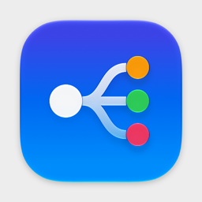

<p align="center">
  
</p>

<h1 align="center">SoundRouter</h1>

<p align="center">
  Per-app audio routing for macOS. Send each app to the output you choose, play an iPad or mic through any output, and switch automatically when devices come and go.
</p>

---

SoundRouter is a native macOS app (Swift, SwiftUI, Core Audio). It replaces the Audio MIDI Setup + LadioCast routine and covers the core features of tools like SoundSource. **No virtual audio driver is installed**: per-app capture uses Apple's Core Audio process taps.

## Features

- **Per-app routing**: Chrome → Speakers and Music → Headset at the same time, each with its own volume up to 400%. Priority lists of outputs, or play on several outputs at once.
- **Input play-through**: play an iPad, iPhone, mic, audio interface or capture card through any output. One switch enables iPad/iPhone audio.
- **Rules and fallbacks**: device priority lists, profiles, and rules triggered by devices connecting or apps launching. When an output disappears, fall back to another device, silence the app, or leave it alone, with an optional alert.
- **Effects**: volume boost with a limiter, balance, Magic Boost (dialogue lift), a 10-band EQ with presets, per-device headphone EQ, and any installed Audio Unit plug-in.
- **Menu bar and always on**: a full window for setup and a compact menu bar panel. Optional start at login, crash relaunch, and a privileged helper for restarting Core Audio without a password.

## Requirements

- macOS 27 or later
- Xcode 27 or later to build

## Build

```bash
git clone https://github.com/luzerdev/SoundRouter.git
cd SoundRouter
open SoundRouter.xcodeproj
```

Or from the command line:

```bash
xcodebuild -project SoundRouter.xcodeproj -scheme SoundRouter build
```

Without a development team the app is ad-hoc signed, which is enough to run it on your own Mac. For the helper daemon and start-at-login, select your team under **Signing & Capabilities** for both the `SoundRouter` and `SoundRouterHelper` targets. If you change the bundle ID, keep the helper's ID as `<app id>.Helper`: the helper uses it to verify that only this app can call it.

## Permissions

| Prompt | Why |
| --- | --- |
| System Audio Recording | Tap other apps' audio (asked the first time an app is routed) |
| Microphone | Read input devices such as an iPad or mic |
| Notifications | Fallback and rule alerts |
| Accessibility | Only if you let the volume keys control devices without hardware volume |

## Documentation

Full documentation (usage, architecture, troubleshooting) is in [`docs/index.html`](docs/index.html).

## Project status

Early. Both targets build with no warnings, and per-app routing has been tested end to end: taps start when a routed app plays, follow the app's processes as instances come and go, and stop when it quits. The UI, input routes, effects, rules and the helper daemon haven't been fully exercised yet. Issues and pull requests are welcome.

## License

[MIT](LICENSE)
